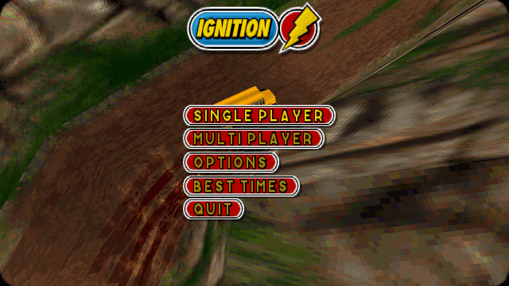
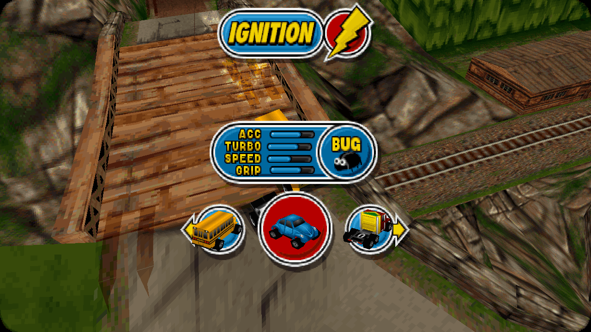
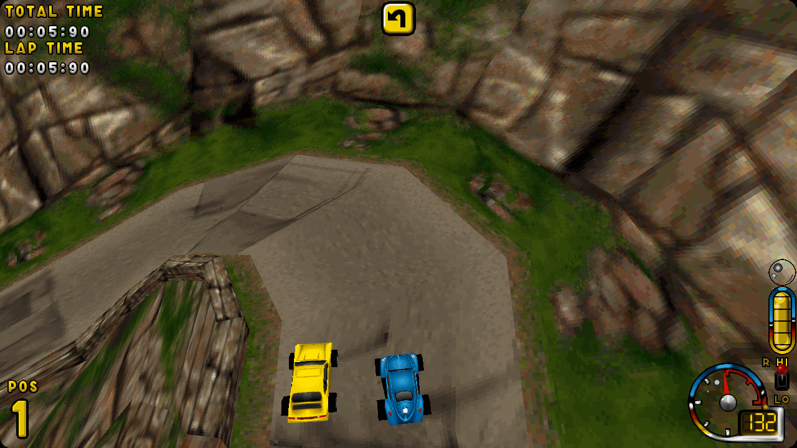
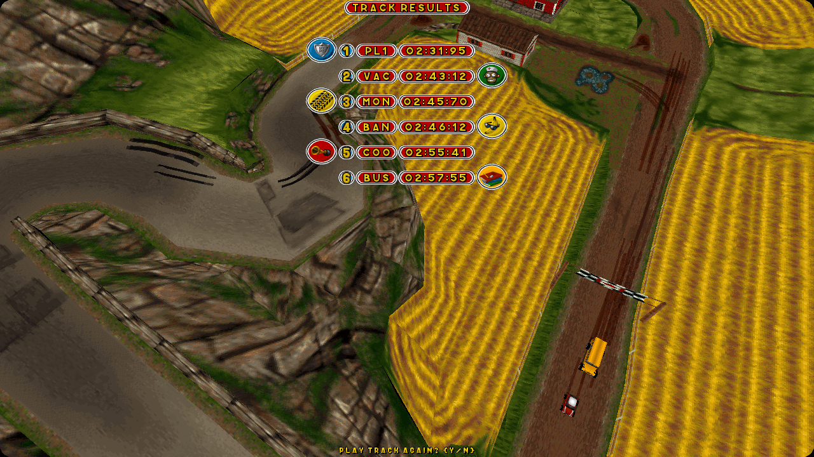

# Ignition

A reimplementation of **Ignition**, the 1997 top-down racing game by Unique
Development Studios, published by Virgin Interactive. The game's Windows 95
executable, `IGN_WIN.EXE`, is reverse engineered and rewritten in portable
C99. The port runs the original game data, which you supply from your own
copy of the game.






## Status

The front end, single races and whole championships are playable from
start to finish: three laps, computer drivers, effects, sound, CD music,
the HUD and the results.

- About 70% of the game's code is ported. [docs/PROGRESS.md](docs/PROGRESS.md)
  lists every routine of `IGN_WIN.EXE` and its status.
- Split-screen two-player races work. Network play is not ported.
- The original's joystick code is not ported. The keyboard works, and on
  every platform but macOS a gamepad presses the game's keys.

### Platforms

| Platform | Host | Renderer | Status |
|---|---|---|---|
| macOS | Cocoa (`src/platform/macos.m`) | OpenGL 3.2 (`src/rnd_gl.c`) | Playable |
| Linux, Steam Deck | X11, GLX, ALSA (`src/platform/linux.c`) | OpenGL 3.2 (`src/rnd_gl.c`) | Runs; tested under Xvfb with Mesa. See [platforms/linux](platforms/linux/README.md). |
| Windows x86_64 | Win32, WGL, waveOut, XInput (`src/platform/windows.c`) | OpenGL 3.2 (`src/rnd_gl.c`) | Runs under Wine; not yet run on Windows. See [platforms/windows](platforms/windows/README.md). |
| Web | Emscripten, WebGL 2, Web Audio (`src/platform/web.c`) | OpenGL ES 3.0 (`src/rnd_gl.c`) | Runs in Chrome. See [platforms/web](platforms/web/README.md). |
| Android | NativeActivity, EGL, AAudio (`src/platform/android.c`) | OpenGL ES 3.0 (`src/rnd_gl.c`) | See [platforms/android](platforms/android/README.md). |
| iOS, iPadOS | UIKit, OpenGL ES, AudioUnit (`src/platform/ios.m`) | OpenGL ES 3.0 (`src/rnd_gl.c`) | Runs in the simulator. See [platforms/ios](platforms/ios/README.md). |
| PlayStation Vita | VitaSDK (`src/platform/vita.c`) | GXM (`src/rnd_gxm.c`) | Playable on hardware; races drop below 36 frames a second where effects pile up. See [docs/vita.md](docs/vita.md). |

The hosts use only each system's own APIs. The project has no third-party
dependencies; `src/third_party/` holds only Khronos' OpenGL headers.
[docs/platforms.md](docs/platforms.md) explains how the platforms share the
code and why DOS, Windows 9x, the PSP and the Analogue Pocket are not
ported.

### Rendering

The original draws in 8-bit colour at 320 x 200, 640 x 480 or 800 x 600.
This port keeps the 8-bit picture and its palette, and draws it on the GPU.
The RESOLUTION menu offers those three modes and one more, **NATIVE**:

- The 3D renders at the window's full resolution and fills the window's
  shape, so a wide window sees more of the track at the sides.
- The menus keep their 4:3 layout at a whole-number scale, and the track
  behind them fills the window.
- The race HUD sits at the window's edges, and the race's messages, boxes
  and results are drawn at the menus' size.

Races run at the original's rate of 36 frames a second, as its game logic
steps 36 times a second. The race effects (smoke, sparks, explosions,
nitro and rain) are drawn at 40% of the original's size.

`--software` (or Alt+R in the game) switches the 2D drawing back to the CPU,
as the original does it. The 3D is always drawn on the GPU.

## Game data

The game data is not in this repository. You need a disc image (`.cue` and
`.bin` files) of your own copy of Ignition.

1. Put the disc image in its own folder under `data/`, for example
   `data/Ignition/`.
2. Run `make extract`. The tool copies the files from each disc image in
   `data/` into a `disc/` folder next to the image.

The game reads its files from `disc/`, and plays the CD music from the disc
image's audio tracks. To use another folder, pass `--data DIR` and
`--cue FILE`.

The packaged builds need no extract step: put the disc image next to the
program (or in the folder each platform's guide names), and the game copies
the files out of it at the first start.

## Build

You need Xcode's command line tools on macOS. To build and run the game:

```bash
make        # builds ./ignition and the extract tool
make run    # builds, then starts the game
make test   # runs the tests that need no game data
make clean
```

The other platforms build from the same Makefile. Each one's guide lists
the tools it needs:

```bash
make linux          # Linux and the Steam Deck: build-linux/ignition
make windows        # Windows, cross-built with MinGW-w64: build-windows/ignition.exe
make web            # the browser, with Emscripten: build-web/dist/
make android        # Android: build-android/ignition.apk
make ios-sim        # iOS, for the simulator
make ios            # iOS: build-ios/ignition.ipa, unsigned
```

For the PlayStation Vita, see [docs/vita.md](docs/vita.md):

```bash
make vita          # builds build-vita/ignition.vpk
make vita-deploy   # copies it to a Vita
```

### Command line

| Option | Effect |
|---|---|
| `--data DIR` | Reads the game files from `DIR`. |
| `--cue FILE` | Plays the CD music from the disc image `FILE`. |
| `--res N` | Forces the resolution: `0` 320 x 200, `1` 640 x 480, `2` 800 x 600, `3` NATIVE. |
| `--software` | Draws the 2D on the CPU. |
| `--fps` | Shows the race's frame rate (Alt+F switches it, and a second Alt+F adds the original's other debug lines). |
| `--view FILE.PIC` | Shows one of the game's pictures. |
| `--text TEXT` | Shows `TEXT` in the game's menu font. |
| `--version` | Prints this port's version. |

These options are for testing:

| Option | Effect |
|---|---|
| `--press MS:KEY[:HOLD]` | Presses `KEY` (a DirectInput scan code in hex) at `MS` milliseconds, held for `HOLD` milliseconds (60 by default). |
| `--shot MS:FILE.tga` | Saves a screenshot at `MS` milliseconds. |
| `--autopilot` | The computer drives the player's car. |
| `--background` | Keeps running when the window is not in front. |

For example, this starts a race in which the computer drives your car, and
saves a screenshot 30 seconds in:

```bash
./ignition --autopilot --press 1500:1c --press 3000:1c --press 5000:1c \
    --press 6500:1c --press 8000:1c --press 9500:1c --press 11000:1c \
    --shot 30000:race.tga
```

## Versions and releases

The port's version is in [VERSION](VERSION). The game logs it after the
original's own version line ("Ignition version 6.53 initiated"), and
`./ignition --version` prints it. [CHANGELOG.md](CHANGELOG.md) lists the
changes in each version.

GitHub Actions builds every platform on each push and pull request
(`.github/workflows/ci.yml`). Pushing a tag `vX.Y.Z` that matches `VERSION`
builds the packages and publishes a GitHub release with that version's
section of the changelog (`.github/workflows/release.yml`). To make a
release:

1. Set the new version in `VERSION`.
2. Move the entries under `[Unreleased]` in `CHANGELOG.md` into a new
   `## [X.Y.Z] - YYYY-MM-DD` section.
3. Commit, then tag `vX.Y.Z` and push the tag.

## How the port is made

Each routine of `IGN_WIN.EXE` is read in IDA and rewritten in C99 that
behaves the same way: the same fixed-point maths, struct layouts and
rounding, and the original's quirks unless a fix is noted. Every ported
function names its address in a comment, for example `/* 0x422680 */`.

- `src/` holds the game, in folders by the original's modules where they
  are known:
  - `src/race/`: the race
  - `src/menu/` and `src/frontend/`: the menus
  - `src/platform/`: one host for each system
  - `src/lisa/`: the original's Lisa 2 library
- `src/structs/` holds the structs, generated from `tools/structs/*.def`
  by `tools/gen_structs.py`, with an assert for every field's offset.
- `src/race/data.c` and `src/menu/data.c` hold the original's tables,
  generated from the executable by `tools/gen_race_data.py` and
  `tools/gen_menu_data.py`.
- `tools/progress.py` writes [docs/PROGRESS.md](docs/PROGRESS.md).
- [docs/formats.md](docs/formats.md) describes the game's files, and
  [docs/engine.md](docs/engine.md) how the engine and its tracks work.

The disassembly and the IDA database are not in this repository.

## Contributing

See [CONTRIBUTING.md](CONTRIBUTING.md) and the
[code of conduct](CODE_OF_CONDUCT.md).

## License

The code in this repository is licensed under the
[GNU General Public License v3.0](LICENSE).

Ignition, its executables and its data are © their respective owners, and
are not included in this repository. This is a preservation project; you
need your own copy of the game to play.
